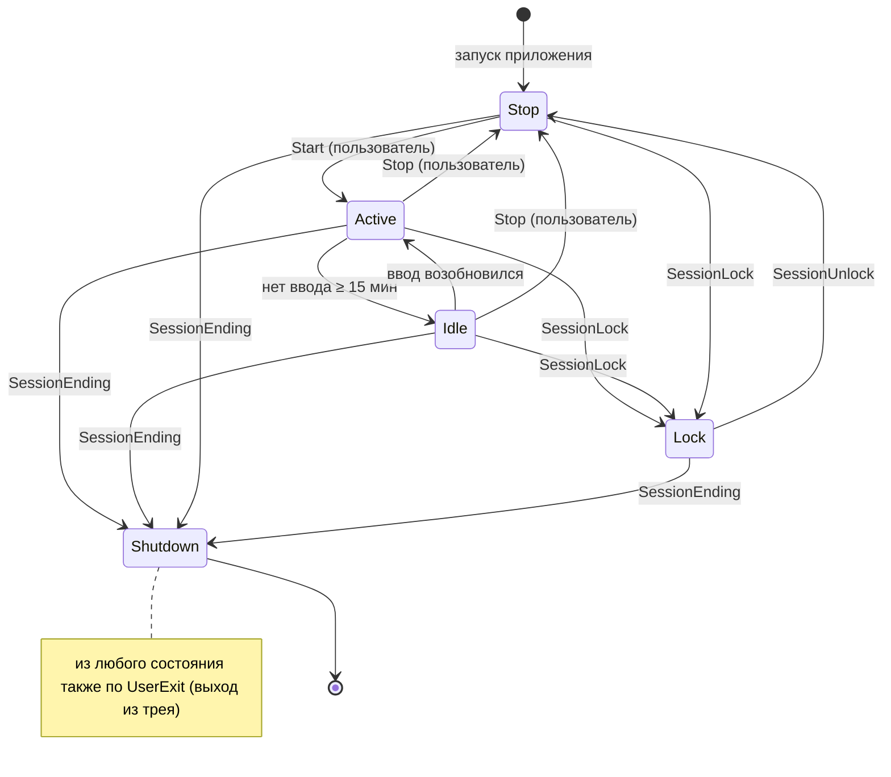

# Time Tracker — Design

## 1. Цель и рамки

Простой таймер учёта времени без проектов, задач и категорий. Пользователь запускает таймер, приложение считает время и само реагирует на неактивность, блокировку и выключение компьютера.

**Входит в решение:**
- состояния `Stop`, `Active`, `Idle`, `Lock`, `Shutdown` и переходы между ними;
- детекция неактивности (нет ввода с клавиатуры и мыши дольше 15 минут);
- остановка таймера при блокировке и выключении;
- длительность текущей дневной сессии;
- ручная корректировка (± минуты);
- просмотр лога изменений состояний.

**Не входит в решение (см. раздел 9):** синхронизация с сервером, несколько пользователей, macOS и Linux, отчёты за период.

**Платформа:** Windows, .NET 10, приложение в трее (WinForms) на Generic Host и DI.

> Почему не ASP.NET или Windows Service: детекция ввода и событий сессии возможна только из процесса в интерактивной сессии пользователя. Служба работает в Session 0 и не видит ввод пользователя. Веб-часть (API или UI для лога) можно добавить поверх, см. раздел 9.

---

## 2. Состояния

| Состояние | Время считается | Смысл |
|---|---|---|
| `Stop` | нет | Начальное состояние при запуске, либо таймер остановлен пользователем |
| `Active` | **да** | Таймер запущен, пользователь работает |
| `Idle` | нет | Таймер запущен, но нет ввода больше 15 минут |
| `Lock` | нет | Компьютер заблокирован |
| `Shutdown` | нет | Сеанс завершён или компьютер выключен (терминальное состояние жизненного цикла процесса) |

Время накапливается **только в `Active`**.

---

## 3. Переходы



| Из | Триггер | В | Примечание |
|---|---|---|---|
| `Stop` | `UserStart` | `Active` | |
| `Active` | `UserStop` | `Stop` | |
| `Active` | `IdleTimeout` | `Idle` | Время перехода равно **моменту последнего ввода**, а не моменту обнаружения (см. 4.1) |
| `Idle` | `InputResumed` | `Active` | Автовозобновление, таймер был запущен пользователем |
| `Idle` | `UserStop` | `Stop` | |
| `Active` / `Idle` / `Stop` | `SessionLock` | `Lock` | |
| `Lock` | `SessionUnlock` | `Stop` | **Решение:** после разблокировки таймер не стартует сам. По условию lock останавливает таймер, и автостарт после долгого перерыва дал бы ложное время |
| любое | `SessionEnding` | `Shutdown` | |
| любое | `UserExit` | `Shutdown` | Выход через меню в трее. Запись нужна, чтобы следующий запуск не принял выход за сбой |
| — | старт приложения после некорректного завершения | `Shutdown` → `Stop` | Восстановление, см. 4.3 |

Недопустимые переходы (например `UserStart` в `Lock`) игнорируются и пишутся в лог диагностики, а не в журнал событий.

---

## 4. Взаимодействие с ОС

### 4.1 Неактивность (`Idle`)

**Выбранный подход:** опрос `GetLastInputInfo` (user32) раз в 5 секунд.

- Функция возвращает tick count последнего ввода (клавиатура или мышь) в текущей сессии.
- `idle = Environment.TickCount64 - lastInputTick`. Сравнение делается по `uint`, потому что 32-битный счётчик переполняется через ~49.7 суток.
- Если `idle ≥ 15 мин` в состоянии `Active`, происходит переход в `Idle` с отметкой `At = now - idle`, то есть на момент последнего ввода. Так 15 минут простоя **не попадают** в учтённое время.
- Если в `Idle` значение `idle` стало меньше интервала опроса, происходит переход в `Active`.

**Почему так:**
- дёшево: один системный вызов раз в несколько секунд;
- не перехватывает содержимое ввода, поэтому не похоже на кейлоггер и не вызывает вопросов у антивирусов и службы безопасности;
- не требует прав администратора.

**Отвергнутые альтернативы:**
- `SetWindowsHookEx(WH_KEYBOARD_LL / WH_MOUSE_LL)`: глобальные хуки тяжелее, видят каждое нажатие и чаще срабатывают в эвристиках антивирусов. Точности сверх 5 секунд они не добавляют.
- Raw Input: те же минусы, что у хуков, плюс больше кода.

**Известные ограничения:**
- Ввод, сгенерированный программно (например, утилитой «не дай компьютеру уснуть»), тоже сбрасывает таймер простоя.
- Просмотр видео или презентации без ввода будет считаться простоем. Это соответствует определению из задания.

Порог 15 минут и интервал опроса задаются в конфигурации (`IOptions<TrackerOptions>`).

### 4.2 Блокировка (`Lock`)

`Microsoft.Win32.SystemEvents.SessionSwitch`: события `SessionLock` и `SessionUnlock` (в том числе `RemoteDisconnect` и `ConsoleDisconnect`, которые считаем блокировкой).

### 4.3 Выключение (`Shutdown`)

**Штатное завершение:** `SystemEvents.SessionEnding` / `WM_QUERYENDSESSION`. Обработчик должен быть быстрым: ОС даёт несколько секунд. Событие пишется синхронно с `Flush`.

**Нештатное завершение** (пропало питание, процесс убит): события не будет. Поэтому:
- каждые 30 секунд пишется **heartbeat**: отдельный маленький файл с перезаписью, в журнал событий он не попадает;
- при старте приложения: если последнее событие в журнале — состояние `Active` или `Idle` без последующего `Stop`, `Lock` или `Shutdown`, в журнал добавляется `Shutdown` с `At = lastHeartbeat` и `Reason = RecoveredAfterCrash`;
- точность восстановления не хуже интервала heartbeat.

> `SystemEvents` нужен цикл обработки сообщений, поэтому выбрано приложение в трее (WinForms), а не консоль.

---

## 5. Модель данных

Источник истины — **append-only журнал событий**. Текущее состояние, длительность сессии и лог для пользователя вычисляются из него.

```csharp
public enum TimerState { Stop, Active, Idle, Lock, Shutdown }

public enum TransitionReason
{
    UserStart, UserStop,
    IdleTimeout, InputResumed,
    SessionLock, SessionUnlock,
    SessionEnding, RecoveredAfterCrash,
    UserExit
}

public abstract record TrackerEvent(Guid Id, DateTimeOffset At);

public sealed record StateChanged(
    Guid Id,
    DateTimeOffset At,            // момент, к которому относится переход
    DateTimeOffset RecordedAt,    // когда реально записали (для Idle и Recovery они различаются)
    TimerState From,
    TimerState To,
    TransitionReason Reason) : TrackerEvent(Id, At);

public sealed record TimeAdjusted(
    Guid Id,
    DateTimeOffset At,
    DateOnly Day,                 // к какому дню относится корректировка
    int Minutes,                  // + или -
    string? Comment) : TrackerEvent(Id, At);
```

**Хранилище:** JSON Lines (`events.jsonl`) в `%LOCALAPPDATA%\TimeTrackerSimple\`. Одна строка на событие, append и flush после каждой записи. Этого достаточно для одного пользователя и легко читается глазами. SQLite стоит взять, когда понадобятся отчёты за период (см. раздел 9).

**Почему журнал, а не «текущее значение счётчика»:**
- лог изменений состояний, который требуется по заданию, получается без отдельного механизма;
- корректировки не перезаписывают данные, их видно и можно отменить;
- можно пересчитать время, если поменяются правила (например, порог простоя);
- проще восстановление после сбоя.

---

## 6. Расчёт дневной сессии

```
Длительность(день) = Σ пересечений интервалов Active с [начало дня; конец дня)
                   + Σ TimeAdjusted.Minutes, где Day = день
```

- Интервал `Active` длится от события `→ Active` до следующего события `Active → *` либо до `now`, если таймер сейчас активен.
- Граница дня — локальная полночь пользователя. Время хранится в UTC (`DateTimeOffset`), день вычисляется через `TimeZoneInfo.Local`.
- Сессия, переходящая через полночь, **делится** между днями.
- Итог не может быть меньше нуля: результат ограничивается нулём (`Math.Max(0, …)`), а в UI выводится предупреждение.
- Время берётся через `TimeProvider` (.NET 8), поэтому расчёт детерминированно тестируется с `FakeTimeProvider`.

**Ручная корректировка:**
- шаг — целые минуты, знак + или −;
- по умолчанию применяется к текущему дню;
- уменьшение ниже нуля за день запрещено (валидация до записи);
- в лог попадает как отдельная запись с комментарием.

---

## 7. Архитектура

```
TimeTracker.Core/                 // без зависимостей от ОС и UI
  TimerState.cs, TransitionReason.cs
  Events/ (StateChanged, TimeAdjusted)
  TimerStateMachine.cs            // таблица переходов → StateChanged | ignored
  SessionCalculator.cs            // длительность дня из журнала
  TrackerService.cs               // оркестрация: команды пользователя + сигналы ОС → журнал
  Abstractions/
    IActivityMonitor.cs           // event IdleDetected(lastInputAt), InputResumed
    ISessionEventsSource.cs       // Lock, Unlock, Ending
    IEventStore.cs                // Append, ReadAll
    IHeartbeatStore.cs

TimeTracker.Windows/              // адаптеры платформы
  LastInputActivityMonitor.cs     // GetLastInputInfo + PeriodicTimer
  SystemEventsSessionSource.cs    // SystemEvents.SessionSwitch / SessionEnding

TimeTracker.Infrastructure/
  JsonLinesEventStore.cs
  FileHeartbeatStore.cs

TimeTracker.App/                  // Winforms, иконка в трее, Generic Host + DI - 
  MainWindow: текущее состояние, длительность дня, Start/Stop, ±мин
  LogWindow: список событий

TimeTracker.Core.Tests/           // xUnit + FakeTimeProvider
```

**Принципы:**
- `TimerStateMachine` — чистая функция `(state, trigger) → transition?`, без побочных эффектов;
- все сигналы, от пользователя и от ОС, обрабатываются одним путём через `TrackerService`, в один поток (`Channel<T>`), что исключает гонки, например одновременные lock и idle;
- адаптеры платформы спрятаны за интерфейсами: ядро тестируется без Windows, а адаптер под macOS или Linux можно добавить отдельно.

---

## 8. Тесты (минимальный набор)

- `Stop` + `UserStart` → `Active`; недопустимый переход игнорируется.
- `Active` → idle через 15 минут: в учтённое время входят 15 минут простоя.
- `Lock` → `Unlock` → таймер в `Stop`, время не растёт.
- Сессия через полночь корректно делится между днями.
- Корректировка −N минут не уводит день в минус.
- Восстановление: журнал заканчивается на `Active` → при старте добавляется `Shutdown` с временем последнего heartbeat.

---

## 9. Что бы улучшил (вне рамок часа)

- **Диалог после простоя:** «Вы были неактивны 23 минуты — учесть это время?», как в Toggl или Clockify.
- Настройки: порог простоя, автостарт при разблокировке, запуск вместе с Windows.
- SQLite вместо JSONL и отчёты за неделю или месяц.
- ASP.NET Core Minimal API + синхронизация на сервер для командного учёта; агент остаётся локальным.
- Адаптеры для macOS (`CGEventSourceSecondsSinceLastEventType`) и Linux (XScreenSaver / D-Bus logind).
- Учёт сна и гибернации (`SystemEvents.PowerModeChanged`): сейчас они ловятся только через heartbeat.
- Метрики и логирование через OpenTelemetry.

---

## 10. Открытые вопросы к заказчику

1. Возвращаться ли в `Active` автоматически после `Unlock`? (Сейчас — нет.)
2. Учитывать ли время простоя по подтверждению пользователя? (Сейчас — не учитывается.)
3. Граница «дня» — полночь или настраиваемое время (например, 04:00 для ночных смен)?
4. Нужна ли история корректировок с возможностью отмены?
